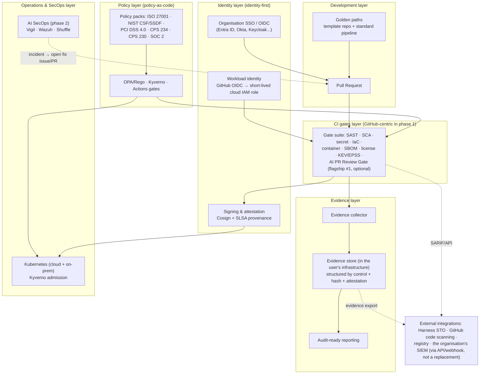

# Reference architecture — devsecops-os

> **Document status (M1)**: this is a *design* document, written
> against the owner-approved blueprint. In the sections below, parts
> marked **[design]** are architectural intent; parts marked
> **[sample configuration]** point to static sample files in
> `docs/examples/`; executable code belongs to the later milestones
> (policy pack — M2, CI gates — M3, evidence automation — M4,
> golden-path template — M5). No part of this document should be read
> as "it already runs", except the sample workload in
> `examples/payments-sample/` (runs locally — see its README).

## 1. Design principles

1. **Vendor-neutral by structure** **[design]**: every scanner and
   connector speaks open formats — SARIF for scan results,
   CycloneDX/SPDX for SBOMs, Sigstore for signing and attestation,
   OSCAL as the evidence exchange format (phase 2). Replacing Trivy
   with Grype or CodeQL with Semgrep must not be allowed to break
   policy or evidence.
2. **Identity-first** **[design]**: no long-lived static credentials
   in the pipeline. People go through the organisation's SSO/OIDC;
   workloads through OIDC federation (GitHub Actions OIDC → a
   short-lived cloud IAM role); artefacts are signed (Cosign) and
   carry provenance attestation (SLSA) instead of "trust it because
   it sits in our registry". Details: `identity-and-access.md`.
3. **Policy at the centre, enforcement at many points** **[design]**:
   the same control intent is compiled down to OPA/Rego
   (configuration checks, Terraform plans), Kyverno (admission on
   Kubernetes) and GitHub Actions gates (blocking merges/releases).
   The policy pack belongs to M2; the gate catalogue to M3.
4. **Evidence is an automatic by-product of operations** **[design]**:
   after each gate run, the evidence collector gathers the results
   into an evidence store structured by control, with integrity
   hashes (M4). Nobody has to "go and gather evidence" at audit time
   any more.
5. **No data leaves the user's infrastructure** **[design]**: every
   component runs in the organisation's own CI, runners and
   clusters; this is a hard condition inherited from flagship #1
   (AI PR Review Gate). No telemetry, no factory-hosted service.

## 2. Architecture diagram

## 3. The layers, by milestone status

| Layer | Components | Milestone with code |
|---|---|---|
| Identity | SSO/OIDC for people; OIDC federation for workloads; Cosign + SLSA for artefacts | Sample configuration at M1 (`docs/examples/`); applied for real through the gates at M3 |
| Development | Golden paths (template repos + standard pipelines) | M5 (design: `golden-paths.md`) |
| CI gates | 10 gates per the blueprint catalogue, section 5 | M3 (`gates/`) |
| Policy | Policy packs for 6 frameworks, enforced by OPA/Kyverno/Actions | M2 (`policies/`) |
| Evidence | Collector + store with integrity hashes + audit reporting | M4 (`evidence/`) |
| Operations & SecOps | Kyverno admission; AI SecOps playbooks (Vigil/Wazuh/Shuffle) | Admission: M3–M4; SecOps: phase 2 |

## 4. The standard flow of a change (design)

1. A developer opens a PR from a repo created by a golden path (or a
   repo that has adopted the system's configuration). The identity of
   the person opening the PR is the organisation's SSO identity.
2. The workflow receives a **short-lived OIDC token** scoped to the
   exact repo/branch/environment — there is no static cloud key in
   the repo's secrets.
3. The enabled gates run in parallel; the policy pack in force
   decides which gates block and which only report (report-only by
   default on first install — see the calibration principle in
   `gates/README.md`).
4. Artefacts that pass the gates are built, get an SBOM, are signed
   with Cosign and carry an attached SLSA provenance attestation.
5. The evidence collector gathers: each gate's results (SARIF), the
   SBOM, attestations, policy decisions, and the PR approval log →
   the evidence store, with a SHA-256 manifest (M4).
6. The deployment layer (Kyverno on Kubernetes) only accepts
   artefacts with a valid signature + attestation; an artefact that
   fails is rejected at admission, and that rejection decision also
   becomes evidence.

## 5. Boundaries of this architecture

- The architecture does **not** include: a home-grown scanner (open
  tools are reused via SARIF), a SOC platform (phase 2 integrates
  Vigil/Wazuh/Shuffle, it does not replace them), a hosted/SaaS
  service, or any mechanism that auto-fixes the user's code.
- Every control mapping mentioned in this document is a **reference
  mapping**, not a compliance certification (see the statement in
  the main README).
- Phase-1 platform coverage: GitHub + GitHub Enterprise Server, with
  on-prem deployment via self-hosted runners. GitLab/Azure DevOps
  are phase 3 — the designed connection points are in
  `integration-points.md`.
