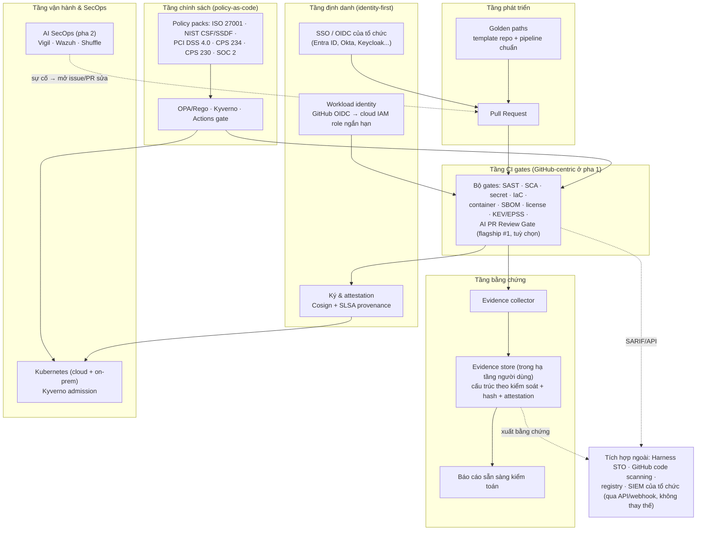

# Kiến trúc tham chiếu — devsecops-os

> **Trạng thái tài liệu (M1)**: đây là tài liệu *thiết kế* theo blueprint đã
> được chủ sở hữu duyệt. Trong các mục dưới đây, phần ghi **[thiết kế]** là ý
> định kiến trúc; phần ghi **[cấu hình mẫu]** trỏ tới file mẫu tĩnh trong
> `docs/examples/`; mã thực thi thuộc các mốc sau (policy pack — M2, CI
> gates — M3, evidence automation — M4, golden-path template — M5). Không
> phần nào trong tài liệu này nên được đọc như "đã chạy được", trừ workload
> mẫu ở `examples/payments-sample/` (chạy local được, xem README của nó).

## 1. Nguyên tắc thiết kế

1. **Vendor-neutral theo cấu trúc** **[thiết kế]**: mọi scanner/connector
   giao tiếp qua định dạng mở — SARIF cho kết quả quét, CycloneDX/SPDX cho
   SBOM, Sigstore cho ký và attestation, OSCAL làm định dạng trao đổi bằng
   chứng (pha 2). Thay Trivy bằng Grype hay CodeQL bằng Semgrep không được
   phép làm gãy policy hay evidence.
2. **Identity-first** **[thiết kế]**: không có credential tĩnh dài hạn trong
   pipeline. Con người qua SSO/OIDC của tổ chức; workload qua OIDC
   federation (GitHub Actions OIDC → cloud IAM role ngắn hạn); artefact
   được ký (Cosign) và có provenance attestation (SLSA) thay cho "tin vì nó
   ở trong registry của ta". Chi tiết: `identity-and-access.md`.
3. **Policy ở trung tâm, thực thi ở nhiều điểm** **[thiết kế]**: cùng một ý
   định kiểm soát được biên dịch xuống OPA/Rego (kiểm tra cấu hình, Terraform
   plan), Kyverno (admission trên Kubernetes) và GitHub Actions gate (chặn
   merge/release). Policy pack thuộc M2; danh mục gate thuộc M3.
4. **Bằng chứng là sản phẩm phụ tự động của vận hành** **[thiết kế]**: mỗi
   lần gate chạy xong, evidence collector gom kết quả vào evidence store có
   cấu trúc theo kiểm soát, kèm hash toàn vẹn (M4). Không ai phải "đi gom
   bằng chứng" mùa kiểm toán nữa.
5. **Không dữ liệu nào rời hạ tầng người dùng** **[thiết kế]**: toàn bộ
   thành phần chạy trong CI/runner/cluster của tổ chức; đây là điều kiện
   cứng thừa hưởng từ flagship #1 (AI PR Review Gate). Không telemetry,
   không dịch vụ hosted của nhà máy.

## 2. Sơ đồ kiến trúc

## 3. Các tầng, theo trạng thái mốc

| Tầng | Thành phần | Mốc có mã |
|---|---|---|
| Định danh | SSO/OIDC cho người; OIDC federation cho workload; Cosign + SLSA cho artefact | Cấu hình mẫu ở M1 (`docs/examples/`); áp dụng thật qua gates ở M3 |
| Phát triển | Golden paths (template repo + pipeline chuẩn) | M5 (thiết kế: `golden-paths.md`) |
| CI gates | 10 gates theo danh mục blueprint mục 5 | M3 (`gates/`) |
| Chính sách | Policy packs 6 khung, thực thi bằng OPA/Kyverno/Actions | M2 (`policies/`) |
| Bằng chứng | Collector + store có hash toàn vẹn + báo cáo kiểm toán | M4 (`evidence/`) |
| Vận hành & SecOps | Kyverno admission; AI SecOps playbooks (Vigil/Wazuh/Shuffle) | Admission: M3–M4; SecOps: pha 2 |

## 4. Luồng chạy chuẩn của một thay đổi (thiết kế)

1. Dev mở PR từ một repo sinh ra bởi golden path (hoặc repo đã nhận cấu
   hình của hệ). Danh tính người mở PR là danh tính SSO của tổ chức.
2. Workflow nhận **token OIDC ngắn hạn** theo đúng repo/branch/environment —
   không có cloud key tĩnh nào trong secrets của repo.
3. Các gate đã bật chạy song song; policy pack đang áp quyết định gate nào
   chặn, gate nào chỉ báo cáo (mặc định report-only khi mới lắp, xem
   nguyên tắc hiệu chuẩn ở `gates/README.md`).
4. Artefact đạt gate được build, sinh SBOM, ký Cosign và đính SLSA
   provenance attestation.
5. Evidence collector gom: kết quả từng gate (SARIF), SBOM, attestation,
   quyết định policy, log phê duyệt PR → evidence store, kèm manifest
   SHA-256 (M4).
6. Tầng triển khai (Kyverno trên Kubernetes) chỉ nhận artefact có chữ ký +
   attestation hợp lệ; artefact không đạt bị từ chối ở admission, và quyết
   định từ chối đó cũng trở thành bằng chứng.

## 5. Ranh giới của kiến trúc này

- Kiến trúc **không** bao gồm: một scanner tự viết (dùng lại công cụ mở qua
  SARIF), một nền tảng SOC (pha 2 tích hợp Vigil/Wazuh/Shuffle, không thay
  thế), một dịch vụ hosted/SaaS, hay cơ chế autofix code của người dùng.
- Mọi ánh xạ kiểm soát nhắc tới trong tài liệu là **ánh xạ tham chiếu**,
  không phải chứng nhận tuân thủ (xem tuyên bố trong README gốc).
- Độ phủ nền tảng pha 1: GitHub + GitHub Enterprise Server, triển khai
  on-prem qua self-hosted runner. GitLab/Azure DevOps là pha 3 — điểm nối
  thiết kế ở `integration-points.md`.
